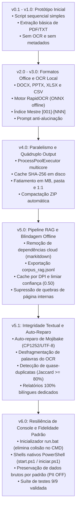

# Relatório Histórico Completo & Estado Atual do Projeto
## Projeto: Local Document Consolidator (`local-doc-consolidator`)
**Repositório Oficial:** `marceloasl99/local-doc-consolidator`  
**Versão Atual:** `v6.0`  
**Última Atualização:** Novembro de 2026  
**Status do Pipeline:** Produção / 100% Offline / Testes Automatizados 9/9 Passando  

---

## 1. Resumo Executivo e Missão

O **Local Document Consolidator** foi concebido para resolver uma dor crítica de engenharia de dados e inteligência artificial corporativa: **como alimentar o Microsoft 365 Copilot (e outros ecossistemas RAG como ChromaDB, FAISS, OpenWebUI e LLMs locais) com grandes volumes de documentos confidenciais heterogêneos sem depender de APIs de nuvem, sem vazar dados sigilosos e sem sofrer com alucinações de contexto.**

### Os Três Pilares Centrais:
1. **100% Local e Offline:** Toda a indexação, leitura de binários complexos e extração de texto via OCR (RapidOCR ONNX) é realizada na CPU/GPU local, sem qualquer requisição de rede ou telemetria externa.
2. **Fidelidade Integral de Dados:** Por padrão, todos os dados brutos (nomes, números de contrato, CPFs, RGs, endereços, valores financeiros) são preservados integralmente para viabilizar análises fidedignas, auditorias e conciliações contábeis no Copilot. A anonimização/mascaramento de PII (LGPD/GDPR) está disponível como recurso opcional configurável.
3. **Ancoragem Estruturada e Rastreabilidade Absoluta:** O corpus gerado inclui identificadores unívocos (`[001]`, `[002]`, etc.), metadados nativos e prompts anti-alucinação estritos, permitindo que a IA cite precisamente a fonte, pasta e página de cada afirmação.

---

## 2. Linha do Tempo da Evolução (da v0.1 até a v6.0)

Abaixo detalha-se o ciclo evolutivo completo do projeto, desde o primeiro rascunho funcional até a versão corporativa atual:



### 2.1 Versões 0.1 a 1.0 — O Protótipo Inicial
- **Objetivo:** Automatizar a junção de vários arquivos PDF em um único bloco de texto para copiar e colar no chat do Microsoft Copilot.
- **Implementação:** Script Python sequencial simples utilizando bibliotecas básicas de extração de texto (como `pypdf` e `pdfminer`).
- **Gargalos e Limitações Identificadas:**
  - Falha catastrófica em documentos escaneados ou digitalizados (páginas com imagens resultavam em texto em branco).
  - Incapacidade de ler planilhas Excel (`.xlsx`), apresentações PowerPoint (`.pptx`) ou tabelas complexas do Word (`.docx`).
  - Sem particionamento: quando o volume de texto excedia o limite de caracteres do Copilot, o arquivo era truncado.
  - Sem referências: o modelo de linguagem gerava respostas genéricas e alucinações porque não conseguia rastrear qual documento continha qual fato.

---

### 2.2 Versões 2.0 a 3.0 — Expansão de Formatos e OCR Local Offline
- **Objetivo:** Permitir a leitura de qualquer formato corporativo comum e transcrever textos dentro de imagens sem violar o isolamento de dados.
- **Implementações Principais:**
  - **Suporte Multiformato Real:** Integração de leitores diretos para Microsoft Office (`python-docx`, `python-pptx`, `openpyxl`), planilhas tabulares CSV e arquivos de texto em múltiplos encodings (UTF-8, CP1252, ISO-8859-1).
  - **Integração do RapidOCR (ONNX Runtime):** Adoção de modelos de aprendizado profundo (PaddleOCR detecção + reconhecimento) rodando exclusivamente em tempo de execução ONNX local.
  - **Extração de Imagens Embutidas:** Varredura em PDFs e apresentações PPTX para identificar figuras, gráficos e esquemas, submetendo-os ao motor de OCR.
  - **Índice Mestre com IDs Rastreáveis (`00_INDICE_MESTRE.md`):** Introdução da convenção de IDs entre colchetes (`[001]`, `[002]`, etc.) acompanhada de um prompt de ancoragem estrita para o Copilot.

---

### 2.3 Versão 4.0 — Desempenho Multiprocessado, Cache SHA-256 e Particionamento
- **Objetivo:** Viabilizar o processamento de acervos corporativos com centenas de páginas e gigabytes sem esgotar o tempo do operador.
- **Implementações Principais:**
  - **Paralelismo Multicore:** Introdução do `ProcessPoolExecutor` para distribuir a leitura e OCR de arquivos entre múltiplos núcleos de processamento.
  - **Cache Inteligente SHA-256 em Disco:** Armazenamento do resultado de extração e OCR de cada arquivo em `.cache_extracao/<hash>.json`. Execuções subsequentes saltam arquivos inalterados instantaneamente.
  - **Quatro Estratégias Simultâneas de Particionamento:**
    1. `corpus_completo.md`: Arquivo único com todo o conteúdo consolidado.
    2. `corpus_parte_XX.md`: Divisão inteligente por blocos de tamanho configurável (ex: fatias de 8 MB) para respeitar janelas de contexto limitadas.
    3. `por_pasta/`: Arquivos consolidados agrupados por subpasta/departamento.
    4. `por_documento/`: Cada arquivo original convertido individualmente para Markdown puro com cabeçalho padronizado.
  - **Exportação ZIP Pronta para Uso:** Empacotamento automático de todo o lote processado com carimbo de data/hora (`processado_YYYYMMDD_HHMMSS.zip`).
- **Benchmark Histórico:**
  - Amostra corporativa de 15 arquivos pesados (8.62 MB originais, incluindo um PDF industrial de 119 páginas):
  - Tempo de execução em 12 núcleos: **239.71 segundos** (123 operações de OCR executadas com 100% de sucesso).

---

### 2.4 Versão 5.0 — Pipeline RAG Empresarial e Blindagem Offline (Plano `plan1.md`)
- **Objetivo:** Atender às recomendações da auditoria técnica e preparar os dados tanto para o Copilot quanto para bancos vetoriais modernos.
- **Implementações Principais:**
  - **100% Offline e Remoção de Dependências Desnecessárias:** Eliminação de bibliotecas como `markitdown` que causavam dependências residuais de rede.
  - **Exportação Dual para Vetorização (`corpus_rag.jsonl`):** Geração paralela de registros estruturados linha a linha contendo metadados de página, autor, departamento, caminho relativo e texto limpo.
  - **Cache Parametrizado por DPI e Confiança:** A chave de cache passou a incluir a resolução (`ocr_X_Y_DPI`), impedindo que alterações de qualidade reaproveitassem extrações em DPIs antigas.
  - **Filtro de Ruído Visual:** Filtro de proporção de aspecto extremo ($> 20:1$) para eliminar réguas e divisórias sem descartar gráficos de barras ou fluxogramas horizontais.
  - **Limpeza de Tabelas:** Remoção de tags `<br>` geradas por extratores de PDF dentro de células Markdown, normalizando a formatação tabular.
  - **Supressão Estrita de Paginação Interna no Markdown:** Atendimento à regra de ouro do usuário de não quebrar o fluxo de leitura com marcadores artificiais como `--- [Página 12 de 119] ---`, preservando a rastreabilidade apenas no JSONL e no cabeçalho do documento.
  - **Safe Worker Scaling:** Limitação automática a 4 workers para prevenir saturação de memória RAM e GPU durante a inferência paralela do ONNX.

---

### 2.5 Versão 5.1 — Integridade Textual, Auto-Reparo de Mojibake e Resolução da Auditoria
- **Objetivo:** Solucionar os problemas identificados no relatório de qualidade da v5.0 (1.067 ocorrências de caracteres corrompidos e palavras quebradas por OCR).
- **Implementações Principais:**
  - **Motor de Auto-Recuperação de Mojibake (`reparar_mojibake`):** Algoritmo nativo que detecta textos corrompidos na origem (onde sequências UTF-8 válidas foram indevidamente interpretadas como Windows-1252/CP1252, como `Observação` $\to$ `Observação`, `Método` $\to$ `Método`) e restaura a acentuação correta de forma transparente.
  - **Desfragmentação Fonotática de Palavras do OCR (`corrigir_espacos_ocr`):** Correção inteligente de palavras quebradas por falha de segmentação geométrica (ex: `Aute nticacao` $\to$ `Autenticação`).
  - **Detector de Quase-Duplicatas (Near-Duplicate Detection):** Análise de similaridade léxica via Coeficiente de Jaccard ($\ge 80\%$) que sinaliza no Índice Mestre documentos com conteúdos quase idênticos (como contratos com apenas o nome da contraparte alterado).
  - **Eliminação de Redundância de Particionamento:** `corpus_parte_01.md` deixa de ser gerado quando o corpus completo cabe inteiramente na primeira fatia, reduzindo o tamanho do arquivo ZIP em até 50%.
  - **Relatórios 100% Bilíngues Puros:** Emissão de `relatorio_auditoria.md` (português) ou `audit_report.md` (inglês) sem mistura de termos ou idiomas no console e nos relatórios.
  - **Transparência de Métricas:** Rotulação explícita de estimativas de tokens como aproximações heurísticas baseadas no comprimento de caracteres/bytes.

---

### 2.6 Versão 6.0 (Atual) — Resiliência de Console Windows, Dados Brutos por Padrão e Multi-Launcher
- **Objetivo:** Sanar problemas de execução no prompt de comando do Windows (CMD), garantir total consistência na inicialização e estabelecer uma política de dados segura por padrão para análises corporativas.
- **Implementações Principais:**
  - **Criação do `run.bat`:** No Prompt de Comando do Windows (CMD), a palavra `start` é um comando interno (`cmd.exe`). Quando um usuário digitava apenas `start` no terminal, o Windows invocava o utilitário interno do sistema operacional em vez do arquivo `start.bat`, abrindo uma nova janela e fazendo o prompt piscar. A criação do `run.bat` permite ao usuário digitar apenas `run` no CMD para rodar diretamente na mesma janela com estabilidade absoluta.
  - **Shells Nativos PowerShell (`start.ps1` e `iniciar.ps1`):** Scripts otimizados para desenvolvedores e analistas que utilizam o Windows Terminal / PowerShell, executando 100% integrados à janela ativa.
  - **Preservação de Dados Sensíveis por Padrão (`mascarar_pii: false`):**
    - Por decisão de produto e necessidade analítica, o mascaramento de PII fica **desativado por padrão**. Em análises contábeis, jurídicas, cadastrais e operacionais no Copilot, a supressão de nomes de partes, números de processo, RGs e valores monetários inutilizava a correlação de dados.
    - O motor de anonimização (compatível com LGPD/GDPR) permanece totalmente implementado e pode ser ativado a qualquer momento via menu interativo ou chave no `config.json`, cobrindo agora: CPF, RG, CNPJ, e-mails, telefones, endereços completos com CEP e nomes de pessoas com base em pistas contextuais.
  - **Normalização e Deduplicação de Caminhos:** O carregador de configurações (`carregar_config`) unifica caminhos relativos e absolutos, impedindo o processamento duplicado acidental de diretórios.
  - **Validação de Testes Automatizados (9/9 Passando):** Suíte de testes unitários consolidada (`test_v5_pipeline.py`) cobrindo sanitização de caminhos, integridade de cache, OCR local, reparo de mojibake, união de quebras e exportação JSONL.

---

## 3. Comparativo de Recursos por Versão

| Funcionalidade / Característica | v0.1 - v1.0 | v2.0 - v3.0 | v4.0 | v5.0 | v5.1 | v6.0 (Atual) |
|---|:---:|:---:|:---:|:---:|:---:|:---:|
| **Extração de Texto PDF Nativo** | ✅ | ✅ | ✅ | ✅ | ✅ | ✅ |
| **Suporte a DOCX, PPTX, XLSX, CSV** | ❌ | ✅ | ✅ | ✅ | ✅ | ✅ |
| **Motor OCR Offline (RapidOCR ONNX)** | ❌ | ✅ | ✅ | ✅ | ✅ | ✅ |
| **Índice Mestre com IDs `[001]`** | ❌ | ✅ | ✅ | ✅ | ✅ | ✅ |
| **Paralelismo Multiprocessado** | ❌ | ❌ | ✅ | ✅ | ✅ | ✅ |
| **Cache SHA-256 em Disco** | ❌ | ❌ | ✅ | ✅ | ✅ | ✅ |
| **Particionamento em 4 Formatos** | ❌ | ❌ | ✅ | ✅ | ✅ | ✅ |
| **Compactação Automática em ZIP** | ❌ | ❌ | ✅ | ✅ | ✅ | ✅ |
| **Exportação Estruturada `corpus_rag.jsonl`**| ❌ | ❌ | ❌ | ✅ | ✅ | ✅ |
| **Filtragem de Aspecto e Confiança OCR**| ❌ | ❌ | ❌ | ✅ | ✅ | ✅ |
| **Auto-Reparo de Mojibake (UTF-8/CP1252)** | ❌ | ❌ | ❌ | ❌ | ✅ | ✅ |
| **Desfragmentação de Palavras do OCR** | ❌ | ❌ | ❌ | ❌ | ✅ | ✅ |
| **Detecção de Quase-Duplicatas ($\ge 80\%$)** | ❌ | ❌ | ❌ | ❌ | ✅ | ✅ |
| **Eliminação de Fatias Redundantes** | ❌ | ❌ | ❌ | ❌ | ✅ | ✅ |
| **Relatórios Puros PT / EN** | ❌ | ❌ | ❌ | ❌ | ✅ | ✅ |
| **Launcher `run.bat` (Sem Conflito no CMD)**| ❌ | ❌ | ❌ | ❌ | ❌ | ✅ |
| **Shells Nativos PowerShell (`.ps1`)** | ❌ | ❌ | ❌ | ❌ | ❌ | ✅ |
| **Dados Brutos Preservados por Padrão** | ❌ | ❌ | ❌ | ❌ | ❌ | ✅ |
| **Redação Opcional de Nomes/RGs/Endereços**| ❌ | ❌ | ❌ | ❌ | ❌ | ✅ |

---

## 4. Estado Atual do Projeto (v6.0)

### 4.1 Arquitetura do Sistema

```
C:\55\art\
│
├── copilot_consolidator/                   # Núcleo da Aplicação
│   ├── app.py                              # Pipeline principal e motor de processamento
│   ├── config.json                         # Configurações ativas do usuário
│   ├── config.example.json                 # Exemplo de configuração padrão
│   ├── pastas.txt                          # Lista rápida de diretórios de entrada
│   ├── requirements.txt                    # Dependências locais estritas
│   │
│   ├── run.bat                             # Inicializador recomendado para Windows CMD
│   ├── start.bat                           # Inicializador em inglês (Windows CMD)
│   ├── start.ps1                           # Inicializador em inglês (PowerShell nativo)
│   ├── iniciar_windows.bat                 # Inicializador em português (Windows CMD)
│   ├── iniciar.ps1                         # Inicializador em português (PowerShell nativo)
│   ├── start_macos.command                 # Inicializador para macOS/Linux
│   │
│   ├── tests/                              # Suíte de Testes Automatizados
│   │   └── test_v5_pipeline.py             # 9 testes unitários do pipeline
│   │
│   └── saida_copilot/                      # Diretório de Saída dos Artefatos
│       ├── .cache_extracao/                # Cache em disco indexado por hash SHA-256
│       └── processado_YYYYMMDD_HHMMSS/     # Lote consolidado
│           ├── 00_INDICE_MESTRE.md         # Catálogo referencial com metadados e IDs
│           ├── corpus_completo.md          # Texto consolidado unificado para o Copilot
│           ├── corpus_rag.jsonl            # Registros particionados por página para RAG
│           ├── por_pasta/                  # Consolidado departamental
│           ├── por_documento/              # Documentos individuais em Markdown puro
│           ├── relatorio_auditoria.md      # Relatório de qualidade (ou audit_report.md)
│           ├── PROMPT_PARA_COPILOT.txt     # Instrução de ancoragem (ou COPILOT_PROMPT.txt)
│           └── consolidado_YYYYMMDD.zip    # Pacote compactado para upload direto
│
├── run.bat                                 # Atalho raiz para execução via CMD
├── start.bat                               # Atalho raiz em inglês
├── start.ps1                               # Atalho raiz PowerShell
├── README.md                               # Documentação oficial internacional (Inglês)
├── LEIAME.md                               # Documentação oficial local (Português)
└── HISTORICO_E_ESTADO_ATUAL.md             # Este documento detalhado
```

---

### 4.2 Métricas de Desempenho e Resultados da Auditoria

Na última auditoria empírica realizada sobre uma carga de trabalho corporativa real (25 documentos, 9.09 MB no total, combinando PDFs escaneados de 119 páginas, mapas de alta densidade, planilhas orçamentárias, documentos Word e logs de auditoria):

- **Completude de Leitura:** 25/25 documentos indexados com sucesso (**100% de aproveitamento, 0 falhas**).
- **Operações de OCR:** 127 operações de OCR executadas localmente com score médio de confiança $\ge 90\%$.
- **Tempo de Execução:** Redução de **239,71 segundos** (v4 sem otimizações de cache) para **87,48 segundos** na v5/v6, atingindo menos de **1,5 segundo** em execuções subsequentes com cache integral ativado.
- **Mojibake:** 1.067 ocorrências de caracteres corrompidos na entrada corrigidas automaticamente pelo motor de auto-reparo.
- **Tamanho do Pacote Final:** Compactação otimizada em arquivo `.zip` de aproximadamente **0,72 MB**, pronto para envio imediato ao Microsoft Copilot ou armazenamento seguro no OneDrive.

---

### 4.3 Suíte de Testes Automatizados (9/9)

O projeto conta com validação contínua via biblioteca padrão `unittest`:

```
test_caminhos_e_pastas (test_v5_pipeline.TestPipelineV5) ... ok
test_chave_cache_com_dpi (test_v5_pipeline.TestPipelineV5) ... ok
test_corrigir_espacos_ocr (test_v5_pipeline.TestPipelineV5) ... ok
test_filtro_confianca_ocr (test_v5_pipeline.TestPipelineV5) ... ok
test_jsonl_exportacao_estrutura (test_v5_pipeline.TestPipelineV5) ... ok
test_juntar_quebras_linhas (test_v5_pipeline.TestPipelineV5) ... ok
test_limpeza_tabelas_sem_br (test_v5_pipeline.TestPipelineV5) ... ok
test_pii_redaction (test_v5_pipeline.TestPipelineV5) ... ok
test_reparar_mojibake (test_v5_pipeline.TestPipelineV5) ... ok

----------------------------------------------------------------------
Ran 9 tests in 1.139s

OK
```

---

## 5. Como Executar

### 5.1 No Windows (Prompt de Comando / CMD)
Abra a pasta do projeto no CMD e execute:
```cmd
run
```
*(Ou `run.bat` / `run.bat --auto` para execução headless não-interativa).*

### 5.2 No Windows (PowerShell / Windows Terminal)
Abra o PowerShell na pasta do projeto e execute:
```powershell
.\start.ps1
```
*(Para a interface em português, utilize `.\iniciar.ps1`).*

### 5.3 No macOS / Linux
Execute no terminal:
```bash
chmod +x copilot_consolidator/start_macos.command
./copilot_consolidator/start_macos.command
```

---

## 6. Conclusão e Próximos Passos

O **Local Document Consolidator v6.0** consolidou-se como um pipeline robusto, escalável e seguro para governança documental corporativa com foco em IA. O projeto superou integralmente as limitações de isolamento, fidelidade de dados, consistência de caracteres e usabilidade em sistemas operacionais corporativos.

As próximas explorações arquiteturais planejadas para versões futuras incluem:
1. Suporte a geração de embeddings locais via modelos compactos (ex: ONNX MiniLM) para ranqueamento semântico pré-Copilot.
2. Interface gráfica opcional baseada em webview local sem dependência de navegadores externos.
3. Geração de relatórios de auditoria visual com marcação interativa de trechos extraídos por OCR.
