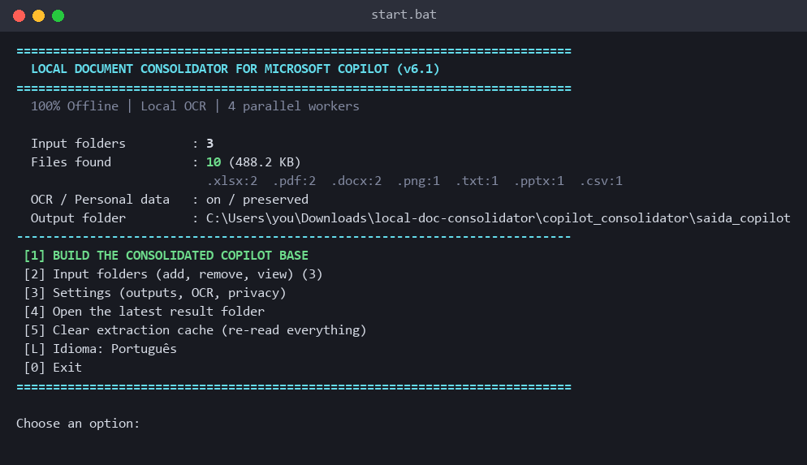
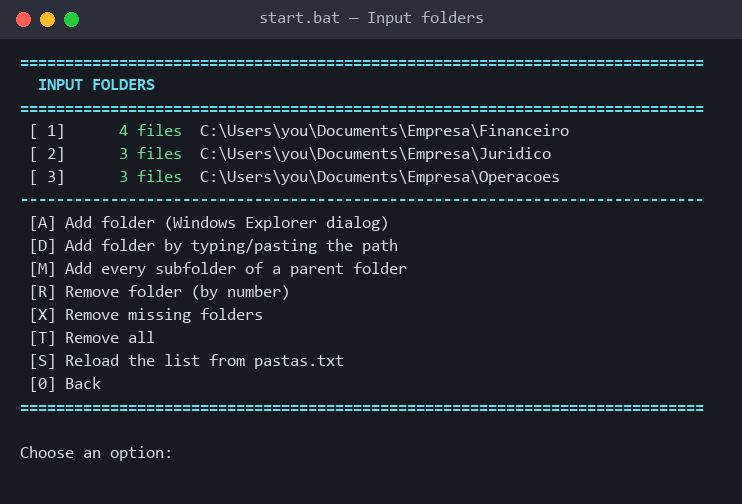
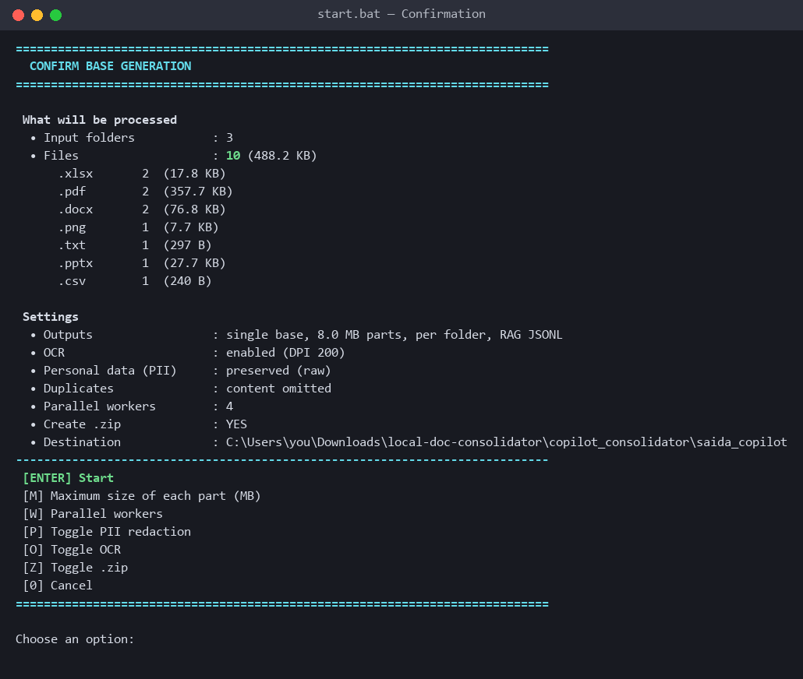
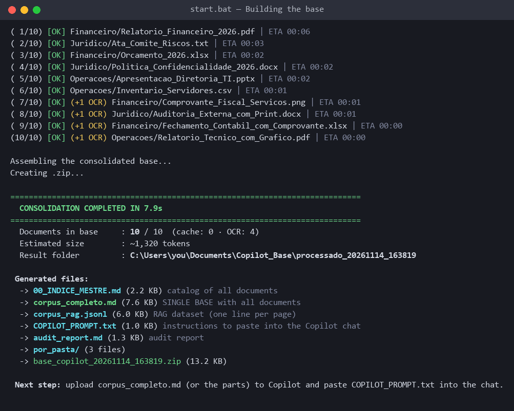
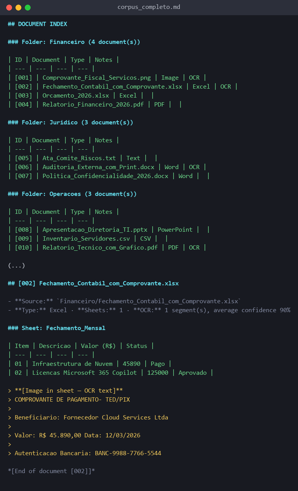

# 📁 Local Document Consolidator for Microsoft Copilot

**Turn hundreds of mixed documents into one organized file that Microsoft 365 Copilot can answer from — 100% offline.**

[](#-quick-start)
[](#-privacy)
[-brightgreen.svg)](#-what-it-reads)
[](LICENSE)

> 🇧🇷 [Leia em português](LEIAME.md) · 🧭 **New to Python or the terminal?** Follow the [step-by-step guide](HOW_TO_USE.md) ([em português](COMO_USAR.md)).

Copilot limits how many files you can attach and struggles to cite sources across scattered documents. This tool reads whole folders of PDFs, Word, Excel, PowerPoint, images and more **on your own computer**, and builds a single Markdown knowledge base where every document has an ID (`[001]`, `[002]`...). Copilot can then answer from it and cite exactly which document each fact came from.

---

## 🚀 Quick start

**1. Install Python 3.10+** from [python.org/downloads](https://www.python.org/downloads/) (on Windows, check **"Add python.exe to PATH"**).

**2. Download this project:** green **Code** button → **Download ZIP** → extract it.

**3. Open the program** (the first run installs everything automatically; it takes a few minutes):

| System | English | Português |
| --- | --- | --- |
| Windows (double-click) | `start.bat` | `iniciar_windows.bat` |
| Windows PowerShell | `.\start.bat` | `.\iniciar_windows.bat` |
| macOS (Terminal) | `bash start_macos.command` | `bash iniciar_macos.command` |

> ⚠️ **Windows:** in PowerShell, type the leading **`.\`** (`.\start.bat`). Typing just `start` or `start.bat` does not run this file: `start` is a built-in Windows command.

**4. In the menu:** `2` → add your folders → `0` → `1` → **Enter**. When it finishes, upload **`corpus_completo.md`** to Copilot and paste the text of **`COPILOT_PROMPT.txt`** into the chat.

<p align="center"></p>

---

## 📸 Screenshots

| 1. Add your folders | 2. Review and confirm |
| :---: | :---: |
|  |  |
| **3. Build the base** (with local OCR) | **4. The result: one organized file for Copilot** |
|  |  |

*Screenshots generated from the sample documents in `copilot_consolidator/exemplos_teste`.*

---

## 📄 What it reads

| Type | Formats | Details |
| --- | --- | --- |
| PDF | `.pdf` | Native text, tables → Markdown tables, **scanned pages via OCR**, repeated headers/footers removed |
| Word | `.docx` | Headings, lists, tables, text boxes and **images (OCR)** in reading order |
| Excel | `.xlsx` `.xlsm` `.xls` | Every sheet as a table, dates/numbers cleaned, **pasted images (OCR)** |
| PowerPoint | `.pptx` | Per slide: title, bullets, tables, **chart data**, images (OCR), speaker notes |
| Images | `.png` `.jpg` `.tif` `.bmp` `.webp` | OCR keeping the line layout of receipts and forms (multi-page TIFF supported) |
| Text & data | `.txt` `.md` `.csv` `.html` `.eml` `.json` `.xml` `.log` | CSV delimiter auto-detected, HTML/e-mail converted to text |

Not supported (listed in the report with a conversion tip): `.doc`, `.ppt`, `.msg`, `.rtf`, archives.

---

## 📦 What you get

Output goes to `copilot_consolidator/saida_copilot/ultimo_processamento/` (plus a timestamped copy):

| File | Use it for |
| --- | --- |
| **`corpus_completo.md`** | **The file to upload to Copilot**: instructions, document index and every document |
| `corpus_parte_XX.md` | Same base split into parts (only when it exceeds the size limit, 8 MB by default) |
| `por_pasta/*.md` | One file per folder/department, for topic-specific questions |
| `00_INDICE_MESTRE.md` | Just the catalog of documents |
| `COPILOT_PROMPT.txt` | Answering rules to paste into the chat |
| `audit_report.md` | What failed, documents without text, low-confidence OCR, duplicates, skipped files |
| `corpus_rag.jsonl` | One record per page for vector databases (Chroma, Qdrant, LangChain) |
| `imagens/` | Ordered folder with saved diagrams and schematics (`docXXX_pYY_figZZ.png`) referenced in the text |

Each document inside the base looks like this:

```markdown
## [004] Financial_Report_2026.pdf

- **Source:** `Company/Finance/Financial_Report_2026.pdf`
- **Type:** PDF · **Pages:** 12 · **OCR:** 3 segment(s), average confidence 91%

(text, headings, lists and tables in the original order)

*[End of document [004]]*
```

**Built-in quality safeguards:** exact duplicates are listed but not repeated · near-identical versions are flagged so Copilot does not mix them · OCR repeated logos are read once · broken OCR words are rejoined without merging acronyms (`LTDA`) · corrupted accents (`Observação` → `Observação`) are repaired · a file that crashes the reader is isolated without stopping the run.

---

## 🔒 Privacy

- Everything runs locally: no cloud APIs, no telemetry (a test enforces that no network library is imported).
- Internet is used **only once**, to install the Python libraries.
- Personal data (CPF, RG, e-mail, phone, addresses, names) is **kept by default** for accurate analysis. To mask it, use menu `3` → `20`, press `P` on the confirmation screen, or run with `--redact-pii`.

---

## ⌨️ Command line (optional)

```bash
python copilot_consolidator/app.py --auto --lang en                       # run with saved settings
python copilot_consolidator/app.py --auto --input "D:\Docs" --output "D:\Base"
python copilot_consolidator/app.py --auto --redact-pii --workers 2 --no-ocr
python copilot_consolidator/app.py --help
```

Settings are saved in `copilot_consolidator/config.json` (created on first use; see `config.example.json`).

## 🧪 Tests

```bash
python -m unittest discover -s copilot_consolidator/tests -v
```

## 🛠️ Troubleshooting

| Problem | Fix |
| --- | --- |
| "Python was not found" | Install Python 3.10+ and, on Windows, check **Add python.exe to PATH**. Reopen the program. |
| Typing `start` opens nothing / another window | Use `.\start.bat` (PowerShell) or double-click `start.bat`. |
| Library installation fails | Check the internet connection; corporate proxies may block `pip`. |
| A document came out "without text" | Scanned file with OCR disabled or an image without readable text; see `audit_report.md`. |
| Need to re-read everything | Menu `5` clears the extraction cache. |

📜 Version history: [HISTORICO_E_ESTADO_ATUAL.md](HISTORICO_E_ESTADO_ATUAL.md) · 📄 License: [MIT](LICENSE)
